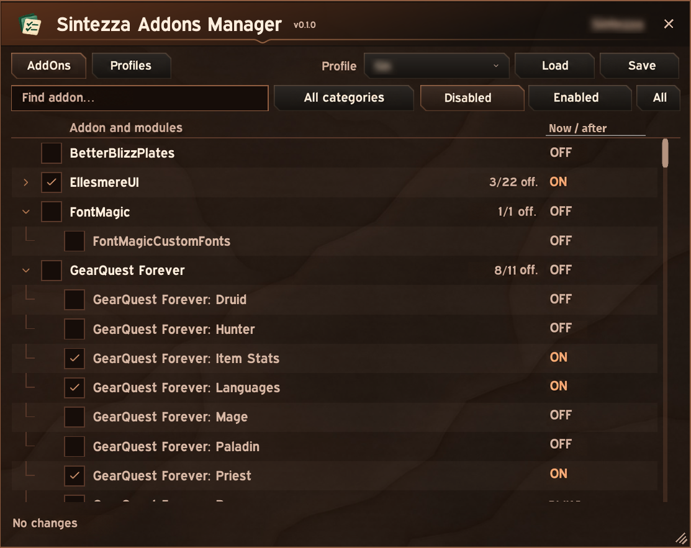

# Sintezza Addons Manager

| CurseForge field | Value |
| --- | --- |
| Game | World of Warcraft |
| Class | Addons |
| Flavor and version | Forever 1.60.1 |
| Main category | Miscellaneous |
| Additional categories | Development Tools |
| CurseForge relations | Sintezza Theme (Optional Dependency) |
| Project license | MIT License |
| Release type | Release |
| Display name | Sintezza Addons Manager 0.1.0 (Forever) |

## Summary

Enable and disable addons, browse module groups, and save addon profiles in WoW Forever.

## Description

Open **Esc → Sintezza Addons Manager** or type `/smanager` to manage your installed addons in WoW Forever. Save different addon sets for raiding, dungeons, or everyday play and load them on any character.

### Find addons and manage modules

The AddOns tab keeps modules under their parent and shows how many are disabled.

Search by name or filter by category and state. Click a checkbox to stage a change, or right-click a group to change all its modules. Required dependencies are included when needed. **Apply** shows the full list of changes before reloading the interface.

### Save and reuse addon sets

Use **Save** to store the list as an account-wide profile. **Load** stages that profile for the current character. The **Profiles** tab shows each saved set and lets you rename or duplicate it. Profiles are loaded manually.

### Appearance

[Sintezza Theme](https://www.curseforge.com/wow/addons/sintezza-theme) is optional. If you use it, open `/stheme` to choose the palette, fonts and shared window settings. The manager window can be resized in either mode. English and Russian are available.

<!-- Changelog field -->

### Changelog

[View the release history on GitHub](https://github.com/ArtefactoO/Sintezza_Manager/blob/main/CHANGELOG.md).

Source, installation details, and credits are available on [GitHub](https://github.com/ArtefactoO/Sintezza_Manager).
