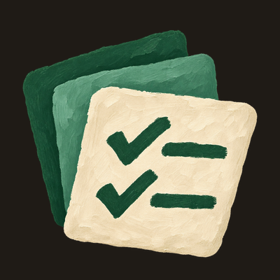
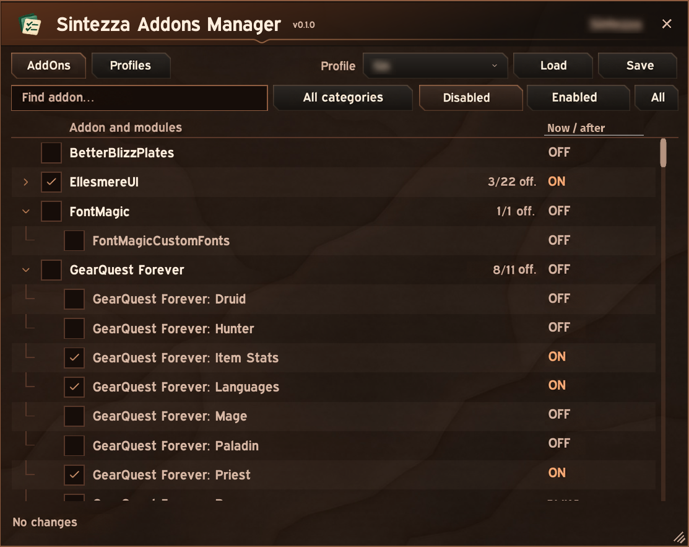

# Sintezza Addons Manager

Manage your WoW Forever addons and share addon sets across characters. Open **Sintezza Addons Manager** from the game menu (**Esc**), Settings → AddOns, or `/smanager`.

The AddOns tab keeps modules under their parent and shows how many are disabled.

The list starts with the Disabled filter. Addons appear once, with modules grouped under their declared parent or an installed required dependency. A state filter includes a group when its parent or a module matches. An expanded group shows both enabled and disabled modules within the current search and category. Hover an addon to see its required dependencies. The checkmark displays the current state and the arrow shows any pending change. Click an addon to change the draft, choose **Apply**, then review and confirm the reload. The manager includes required dependencies when enabling an addon and accounts for dependents when disabling one.

Use the disclosure arrow to collapse a group. The counter shows how many modules are off out of the total, or how many are on when all are enabled. Search by title or folder name to temporarily open branches with matching modules. Right-click a group to stage a change for all its modules.

Choose a profile in the **AddOns** tab and select **Load** to stage its set for the current character. If a different draft is pending, the manager asks before replacing it. **Apply** sets up the addon's choices for the current character and reloads after confirmation. **Save** writes the list, including pending edits, back to the selected profile. Choose **New profile…** to save a separate set. Saved profiles are shared across the account, and each character loads them manually. Newly installed addons keep their current state unless a required dependency needs a change.

The **Profiles** tab shows the saved contents of each set. Use **Rename**, **Duplicate**, or the profile's context menu to organize your sets. A duplicate is an independent copy of the saved addon set.

Install the `Sintezza_Manager` folder in `Interface/AddOns` and restart WoW if it is already running. Sintezza Theme is optional. When loaded, it supplies the palette, fonts and widgets. Otherwise the manager uses its own appearance and the client language. English and Russian are available.

Drag the bottom-right corner to resize the window. The minimum width is 480 UI pixels, and the toolbar uses shorter labels at narrow sizes. The size is saved for the account. When Sintezza Theme is active, the manager follows the global window scale, opacity and layer. Settings → AddOns → Sintezza Addons Manager has a per-window scale control when Theme is loaded and a size reset in both modes.
